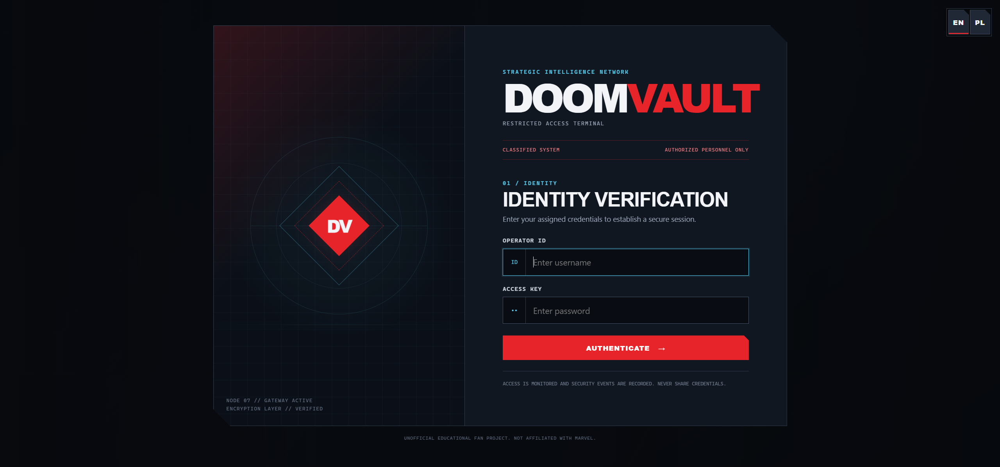
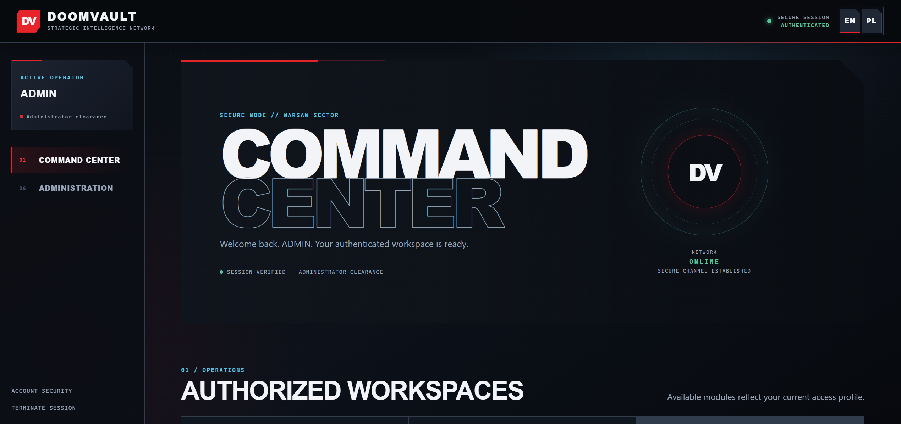
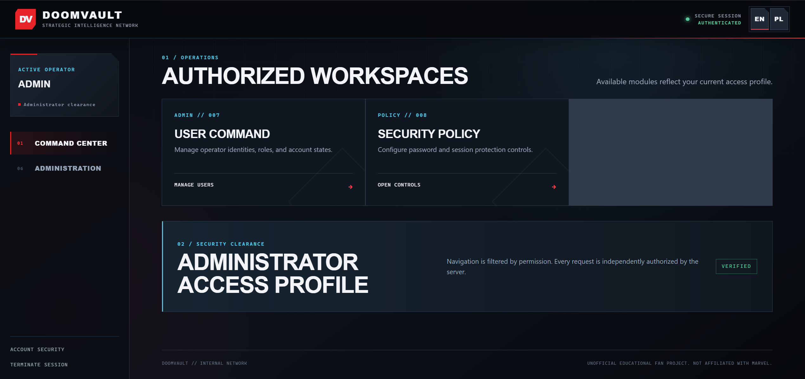

# DoomVault

## Identification, Authentication and Authorization in a Secure Web Application

**Cybersecurity Laboratory Project**  
**Individual Variant 10**  
**Report language:** English  
**Project type:** Individual project

> DoomVault is an unofficial educational fan project. It is not affiliated with, endorsed by, or associated with Marvel or Disney.

---

## Table of Contents

1. Introduction
2. Project Objectives and Requirements
3. Technologies and Architecture
4. Database Design
5. Authentication and Password Security
6. Sessions and Authorization
7. Application Functionality
8. Application Interface
9. Security Testing and Results
10. Answers to Control Questions
11. Conclusions
12. References and Source Code

---

# 1. Introduction

Web applications frequently need to answer three related but distinct questions. **Identification** is the act of presenting an identity, such as a username. **Authentication** establishes whether the person presenting that identity possesses an accepted credential. **Authorization** determines which actions and resources an authenticated identity may use. Confusing the three creates security failures: a known username is not proof of identity, and a successful login does not imply permission to every function or record.

DoomVault was developed to demonstrate these mechanisms in a compact academic application. It is a fictional classified-intelligence archive with user administration, security-policy controls, incident reporting, classified dossiers, and a controlled approval and declassification workflow. The Marvel-inspired presentation makes the laboratory easier to explore, while the implementation focuses on conventional web-security principles.

The project treats security as a chain rather than a single login check. A request must carry a valid server-side session, the account must still be active and unblocked, the role must still match the role at authentication time, the role must have the requested permission, and the resource must satisfy ownership, classification, and lifecycle rules. State-changing requests also require a valid CSRF token. This layered model is important because no isolated control can safely replace the others.

# 2. Project Objectives and Requirements

The objective of individual variant 10 was to build a web application that demonstrates identification, secure authentication, authorization, and administrative security controls. DoomVault implements the assignment as an individual Python/Flask project and keeps its data model and workflows inspectable for academic review.

## 2.1 Roles and identities

The application has five roles, without inheritance or an implied hierarchy:

- **Administrator:** manages identities, roles, account state, password policy, and session-policy settings. This role receives no dossier access automatically.
- **Manager:** reads authorized classified records, reviews pending dossiers, approves or rejects them, and declassifies eligible approved records.
- **Editor:** reviews submitted incidents, creates dossier drafts, edits owned drafts, and submits owned drafts.
- **Employee:** submits incident reports, reads only owned reports, and reads declassified dossiers.
- **Reader:** has read-only access to declassified dossiers.

The seed catalog creates eight inactive identity records: the permanent `ADMIN` identity plus seven disposable test identities (`director01`, two editors, two agents, and two readers). These records have no usable credential when seeded. The permanent administrator name is protected by database triggers against renaming and deletion; the application also protects it in administrative services. A seed record becomes usable only when a local operator explicitly provisions it.

## 2.2 Variant 10 credential policy

The implemented permanent-password minimum is 14 characters. An administrator may raise the configured minimum, but the policy layer will not accept a configured value below 14. DoomVault does not require uppercase, lowercase, digit, or symbol composition. A configurable forbidden-word policy compares proposed passwords with administrator-managed dictionary entries using a normalized comparison representation. The accepted password text itself is passed unchanged to Argon2id.

Temporary credentials have the form `word-word-word-00`: three independently selected random words followed by two random digits. They are stored only as Argon2id hashes, expire after at most 12 hours, and are invalidated when used or superseded. Authentication with a temporary credential creates a restricted setup session; the user must establish a permanent password before accessing ordinary protected functions.

The administrator can manage the minimum password length, forbidden-word enforcement and entries, password-history depth, optional permanent-password validity days, and session inactivity timeout. The default history depth is five, periodic expiration is disabled by default, and inactivity timeout defaults to 15 minutes. Resetting a password issues a new temporary credential, requires a new permanent password, and revokes existing sessions.

# 3. Technologies and Architecture

## 3.1 Technology choices

Python 3.11+ provides the application language and standard modules used for cryptographic randomness, hashing session identifiers, JSON processing, filesystem operations, timestamps, and SQLite access. Flask 3.1 supplies routing, request/response handling, an application factory, CLI commands, Jinja2 integration, and blueprint composition. Jinja2 renders the server-side HTML interface with automatic escaping. CSS and vanilla JavaScript provide the visual design and small client-side interactions without introducing a frontend framework.

SQLite was selected because the project is an individual laboratory system with a clear relational model and no infrastructure requirement. The built-in `sqlite3` module supports parameterized queries, foreign keys, conditional updates, and explicit transactions. It is not presented as a horizontally scalable production datastore.

`argon2-cffi` provides a maintained implementation of Argon2id. Its high-level `PasswordHasher` generates a salt, encodes parameters with the hash, and verifies candidates without DoomVault implementing cryptography. pytest supplies isolated regression tests across authentication, session, authorization, administration, dossier, workflow, localization, and hardening behavior.

## 3.2 Major components

```text
Browser
  |-- host-only authentication cookie
  |-- CSRF cookie + submitted token
  v
Flask application (app.py)
  |-- auth/       identification, verification, password change, sessions
  |-- modules/    admin, incident, dossier, and approval routes/services
  |-- security/   RBAC, resource policy, CSRF, errors, audit events
  |-- templates/ + static/ + locales/
  v
SQLite metadata  <---- consistency boundary ---->  private JSON dossiers
```

`app.create_app()` creates an instance-relative Flask application, initializes database and command integrations, registers authentication and localization hooks, and registers the administration, dossier, and incident blueprints. It also exposes permission-derived booleans to templates. These booleans determine visible navigation but never replace route authorization.

Routes translate HTTP input into calls to focused policy and service functions. Database queries are parameterized. State-changing services use an immediate SQLite transaction where consistency or concurrent updates matter. Dossier services combine SQLite metadata with a private JSON document, using atomic filesystem replacement and compensating restoration if a later database operation fails.

Detailed structure is documented in `docs/architecture.md`.

# 4. Database Design

The database schema is defined in `schema.sql`. The default relative filename is resolved inside Flask's instance directory, producing `instance/doomvault.db`; `DOOMVAULT_DATABASE` can override it. Foreign-key enforcement is enabled on every connection. Timestamps are UTC text values in `YYYY-MM-DDTHH:MM:SSZ` form.

## 4.1 Tables and relationships

| Table | Purpose and important relationships |
| --- | --- |
| `roles` | Five allowlisted role names. One role can be referenced by many users and grants. |
| `permissions` | Fourteen allowlisted action names. |
| `role_permissions` | Composite-key join table between roles and permissions. |
| `users` | Identity, role, account state, current password hash, password-change state, and timestamps. |
| `password_history` | Prior Argon2id hashes for a user; supports reuse checks. |
| `temporary_passwords` | Hashed temporary credentials with creation, expiry, and use timestamps. |
| `sessions` | Hashed session token, activity and expiry timestamps, revocation, credential kind, and role snapshot. |
| `forbidden_words` | Administrator-managed entries used by permanent-password policy. |
| `settings` | Key/value security policy, including length, history, timeout, and validity values. |
| `dossiers` | Authoritative dossier metadata, ownership, approval and declassification actors, source incident, and workflow timestamps. |
| `incident_reports` | Employee-owned incident text and workflow status. |
| `security_events` | Sanitized event metadata linked to an actor where available. |

```text
roles 1---* users 1---* sessions
  |              |\---* password_history
  |              \----* temporary_passwords
  *
  |
  * permissions (through role_permissions)

users 1---* incident_reports
users 1---* dossiers (created_by, approved_by, declassified_by)
incident_reports 0..1---0..1 dossiers (source_incident_id)
users 1---* security_events
```

The `users.username` column is case-insensitively unique. Account deletion is represented by `deleted_at` so historical ownership and events remain referentially intact. Database triggers prevent changing or deleting the `ADMIN` username. `sessions` contains `role_id_at_creation`, allowing the application to revoke a session whose user's role changes.

`dossiers.id` follows `DV-XXX`. Constraints limit organizations, classifications, and lifecycle statuses. Foreign keys identify creator, approver, declassifier, and optional source incident. A partial unique index on `source_incident_id` prevents one incident from being converted twice.

## 4.2 Relational metadata and JSON content

SQLite is authoritative for authorization-relevant data: dossier identity, title, organization, classification, status, file name, creator, reviewer, source incident, rejection reason, and timestamps. Each corresponding JSON file contains the bounded display document and incident narrative. This separation keeps relational queries and authorization decisions simple while demonstrating safe document storage.

JSON files are UTF-8, size-bounded to 16 KiB by default, located outside public static paths, and accepted only when identifier and filename relationships are valid. The storage layer rejects traversal, absolute or malformed filenames, unexpected extensions, mismatched document IDs, and symbolic-link targets. It parses JSON with the standard library and never evaluates the content.

# 5. Authentication and Password Security

## 5.1 Login and verification

The login route receives a username and password, performs bounded shape validation and throttling, and calls `auth.login.authenticate()`. The service locates the account by the case-insensitive username constraint and checks account state. To reduce the timing distinction for an unknown identity, the implementation verifies against a valid dummy Argon2id hash. A successful permanent or active temporary credential opens a server-side session; failures use generic responses and sanitized events.

Passwords are never stored in plaintext. The essential wrapper in `auth/passwords.py` is:

```python
_HASHER = PasswordHasher(type=Type.ID)

def hash_password(password):
    if not isinstance(password, str) or password == "":
        raise ValueError("Password must be non-empty text.")
    return _HASHER.hash(password)

def verify_password(stored_hash, password):
    try:
        return bool(_HASHER.verify(stored_hash, password))
    except (VerificationError, InvalidHashError):
        return False
```

The library generates a unique salt for each call to `hash()`. Argon2id is deliberately expensive in time and memory, increasing the cost of offline password guessing. The salt prevents identical passwords from producing the same encoded value and defeats precomputed rainbow tables. By contrast, general-purpose SHA-256 is intentionally fast and is unsuitable by itself for password storage. DoomVault uses SHA-256 only for high-entropy random session-token lookup values, not for human passwords.

## 5.2 Permanent-password validation

`auth.password_policy.validate_permanent_password()` collects violations for length, forbidden terms, confirmation mismatch, and reuse. Its central checks are:

```python
minimum = minimum_password_length(connection)
if len(password) < minimum:
    violations.append(PolicyViolation("too_short", minimum=minimum))
if forbidden_words_enabled(connection) and _contains_forbidden_word(
    connection, password
):
    violations.append(PolicyViolation("forbidden_word"))
if user_id is not None and _reuses_previous_password(
    connection, user_id, password
):
    violations.append(PolicyViolation("reused_password"))
```

The default minimum is 14 characters because that is the project requirement. Forbidden-word entries are case-folded and Unicode-normalized for comparison. Accents and Polish `ł` are handled consistently by the comparison form. This project performs substring matching against its local policy dictionary; that is an implementation choice and should not be confused with every detail of current NIST blocklist guidance.

When a password changes, the previous current hash is copied to `password_history`, the new Argon2id hash and timestamps are stored, unused temporary credentials are marked used, and history is trimmed to the configured limit. Reuse detection asks Argon2id to verify the candidate against the current and retained hashes; it does not compare plaintext.

## 5.3 Temporary credentials and resets

`auth.temp_passwords.generate_temporary_password()` uses `secrets.choice` for three entries from a wordlist of at least 2,048 values and `secrets.randbelow(100)` for two digits. The format is validated by `^[a-z]+-[a-z]+-[a-z]+-[0-9]{2}$`. The plaintext is returned to the local provisioning operator once, while only an Argon2id hash and expiry are committed.

Only one current temporary credential remains active for the account. Provisioning activates a non-blocked identity; reset operations can clear the permanent hash, require a new password, and revoke all existing sessions. A temporary login is reserved through its setup session so it cannot be used to create parallel ordinary access. Completing the password change consumes outstanding temporary credentials and rotates session state.

# 6. Sessions and Authorization

## 6.1 Server-side sessions

The browser cookie is an opaque random token, not a serialized user identity or permission list. `auth.sessions.create_session()` generates it and stores only a digest:

```python
token = secrets.token_urlsafe(32)
connection.execute(
    """INSERT INTO sessions (
           user_id, session_token_hash, created_at, last_activity_at,
           expires_at, credential_kind, temporary_password_id,
           role_id_at_creation
       ) VALUES (?, ?, ?, ?, ?, ?, ?, ?)""",
    (..., hash_session_token(token), ..., user["role_id"]),
)
```

The 32 random bytes provide 256 bits of source entropy. SHA-256 is acceptable here as a one-way lookup verifier because the source token is already random and unguessable; password stretching is intended for low-entropy human secrets. The cookie is host-only because no `Domain` attribute is set, `HttpOnly`, and `SameSite=Strict`. Production mode adds `Secure`, which requires HTTPS. A separate CSRF cookie and submitted token protect mutations.

`validate_session()` rejects missing or malformed tokens, revoked rows, absolute or inactivity expiration, invalid timestamps, inactive, blocked, or deleted accounts, and role changes. Active requests can slide both `last_activity_at` and `expires_at`. Logout and security-sensitive account/password changes set `revoked_at`; revoked database state takes effect even if a browser still holds the cookie.

## 6.2 RBAC matrix

The matrix below is derived from `seed.py`, not from the visible menu:

| Permission | Admin | Manager | Editor | Employee | Reader |
| --- | ---: | ---: | ---: | ---: | ---: |
| `users.manage` | Yes | No | No | No | No |
| `security.manage` | Yes | No | No | No | No |
| `dossiers.read_declassified` | No | Yes | Yes | Yes | Yes |
| `dossiers.read_classified` | No | Yes | No | No | No |
| `dossiers.read_doom_level` | No | Yes | No | No | No |
| `dossiers.read_own_drafts` | No | No | Yes | No | No |
| `dossiers.create` | No | No | Yes | No | No |
| `dossiers.edit_own` | No | No | Yes | No | No |
| `dossiers.submit_own` | No | No | Yes | No | No |
| `dossiers.review` | No | Yes | No | No | No |
| `dossiers.declassify` | No | Yes | No | No | No |
| `incidents.create` | No | No | No | Yes | No |
| `incidents.read_own` | No | No | No | Yes | No |
| `incidents.read_submitted` | No | No | Yes | No | No |

`security.permissions.has_permission()` resolves the active user's current role and explicit grants from SQLite. Unknown permission names, invalid roles, database errors, or invalid account/session context produce no grants. `require_permission()` wraps route functions, and state-changing services repeat relevant checks inside the transaction.

## 6.3 Resource-level restrictions

RBAC alone is insufficient. An editor with `dossiers.edit_own` may edit only a dossier whose `created_by` matches the authenticated identity, whose status is exactly `DRAFT`, and whose classification is neither `DECLASSIFIED` nor `DOOM_LEVEL`. Employees with `incidents.read_own` likewise see only reports they created.

`can_access_dossier()` combines permission, classification, status, and ownership. Declassified access requires both classification and status to equal `DECLASSIFIED`. Classified access is limited to review states. Drafts and rejected records require ownership and the own-draft grant. `DOOM_LEVEL` requires both `dossiers.read_classified` and `dossiers.read_doom_level`; the standard declassification route rejects it even for a manager.

An existing but unauthorized resource produces HTTP 403 through the common denial behavior. Missing or structurally invalid resources use HTTP 404. A hidden link or button is therefore only a user-interface convenience. Direct requests still pass route, permission, ownership, classification, and workflow checks.

# 7. Application Functionality

## 7.1 Administration

Administrators can create user identities, assign one of the five roles, block or unblock accounts, soft-delete eligible accounts, and issue a temporary reset credential. Changing a role or account state revokes affected sessions. The permanent `ADMIN` identity cannot be renamed or deleted. Administrative authority is intentionally separated from archive access.

The security-policy interface allows management of minimum password length, forbidden-word checking, dictionary entries, password-history limit, optional password-validity days, and inactivity timeout. Inputs are bounded and policy changes are audited in the same transaction. Temporary credential validity is displayed as a capped 12-hour property rather than an unrestricted control.

## 7.2 Incident and dossier lifecycle

Employees submit incident reports. The server supplies the owner from the authenticated session and begins the report in `NEW`; submitted ownership or status values are not authoritative. Employees see only their own reports.

Editors can review submitted incidents and convert one into an owned dossier draft. Conversion copies bounded report material into the dossier, records `source_incident_id`, changes the report to `PROCESSED`, and preserves the source report. A unique index and conditional update protect against duplicate conversion.

Editors may also create a new `INTERNAL` or `SECRET` draft, edit an owned `DRAFT`, and submit it for review. IDs are generated by the server. Submitted protected metadata cannot override ownership, status, approval identity, or timestamps.

Managers see only pending dossiers they are authorized to review. They can approve or reject a `PENDING` record. Rejection requires a reason of at most 500 characters and is terminal in the implemented workflow. Approval retains the classification; publication does not occur automatically. A separate confirmed action can declassify an accessible, non-`DOOM_LEVEL`, `APPROVED` dossier. That action changes both classification and status to `DECLASSIFIED`, allowing roles with `dossiers.read_declassified` to read it.

```text
Incident: NEW --editor conversion--> PROCESSED + owned DRAFT

Dossier:  DRAFT --submit--> PENDING --approve--> APPROVED
                                   \--reject---> REJECTED
                   APPROVED --confirmed declassification--> DECLASSIFIED
```

JSON and SQLite updates are kept consistent with immediate transactions, conditional status changes, atomic replacement, and restoration on error. Successful actions create sanitized event records; descriptions do not include credentials, session values, dossier content, rejection text, or filesystem paths.

## 7.3 Classification and localization

The schema supports `DECLASSIFIED`, `INTERNAL`, `SECRET`, `TOP_SECRET`, and `DOOM_LEVEL`. Classification and lifecycle status are independent until declassification explicitly sets both to `DECLASSIFIED`. Editors can author only `INTERNAL` and `SECRET` dossiers. `TOP_SECRET` exists for seeded and controlled classified records; `DOOM_LEVEL` adds the strongest implemented read gate and cannot enter the ordinary release path.

The interface is available in English and Polish. Localization changes messages and labels but never permissions. The language switch is CSRF-protected, and its return target must be a safe root-relative internal path.

# 8. Application Interface

DoomVault uses a fictional classified-terminal aesthetic: dark panels, restrained accent colors, classification labels, and command-center navigation. This theme supports the scenario without claiming to be an official Marvel product. Server-rendered pages remain the authoritative interface, and visible navigation is derived from current permission checks.



**Figure 1. Secure Authentication Terminal.** The login interface identifies the requested account and accepts a password. Authentication failures are deliberately generic.



**Figure 2. Intelligence Command Center.** The authenticated landing view presents operational context and role-relevant entry points.



**Figure 3. Authorized Workspaces.** Available workspaces reflect current role permissions. Their visibility improves usability but grants no authority; direct requests are checked on the server.

The screenshots contain no credentials or reusable session data. They document the implemented Task6.1 interface rather than generated mockups.

# 9. Security Testing and Results

The project uses pytest with temporary databases and dossier directories. `docs/security_review.md` records the focused Task6.1 review performed on 23 October 2026. The review combined targeted source inspection, the existing suite, and regression tests; it was not an external penetration test.

The recorded full-suite result is **601 passed and 1 skipped**. This report relies on that preserved Task6.1 evidence and did not independently rerun the entire suite during documentation finalization. Targeted localization and response-header regression tests were also recorded as passing.

The suite covers important authentication cases including invalid credentials, blocked accounts, temporary credentials, mandatory password replacement, password policy, history, and reset behavior. Session tests exercise inactivity and absolute timestamps, revocation, sliding expiry, role-change invalidation, cookie behavior, and login/setup boundaries.

Authorization tests cover explicit RBAC grants, removal of live permissions, absence of an administrator bypass, ownership, incident privacy, classified dossier restrictions, and the additional `DOOM_LEVEL` gate. Route tests check HTTP 401/403 behavior and direct access, demonstrating that navigation visibility is not the security boundary.

Input and browser-security coverage includes CSRF failures, bounded form values, parameterized search with literal wildcard escaping, Jinja output escaping, safe localization redirects, security headers, and generic error handling. Dossier tests cover malformed or oversized JSON, traversal, identifiers, storage outside static paths, symbolic links where the host permits creation, atomic writes, rollback restoration, and content-free event logging.

Workflow tests exercise conversion, ownership, submission, approval, rejection, declassification, invalid transitions, conditional-update conflicts, duplicate conversion prevention, rollback behavior, and `DOOM_LEVEL` release denial. Administrative tests cover account lifecycle, permanent `ADMIN` restrictions, policy bounds, dictionary normalization, audit rollback, and secret-free events.

The focused review found and corrected one medium-severity unsafe localization return-path condition involving leading triple slashes. It also added a restrictive Content Security Policy and production-only HSTS while retaining `nosniff`, anti-framing, no-referrer, and no-store protections. No Critical or High finding was confirmed in that scoped review. The evidence does not claim complete security, scanner coverage, external penetration testing, or production infrastructure validation.

# 10. Answers to Control Questions

## 10.1 Why use trusted cryptographic libraries instead of custom cryptography?

Cryptographic algorithms and their safe use contain details that are easy to implement incorrectly: randomness, salts, parameters, encodings, failure behavior, side channels, and upgrade paths. A maintained library concentrates specialist review and interoperability testing in one implementation and can update defaults as research changes. Application code should choose an appropriate primitive, validate its inputs, and handle its API safely rather than recreate the primitive.

DoomVault therefore uses `argon2-cffi`'s `PasswordHasher` with `Type.ID` and Python's `secrets` module. The project does not implement Argon2, a salt generator, or a pseudorandom generator. Library use is not a complete security guarantee, but it removes a large and unnecessary class of custom-cryptography errors.

## 10.2 How does Argon2id compare with SHA-256 for password storage?

SHA-256 is a fast general-purpose cryptographic hash. Speed is useful for integrity and for hashing an already-random session token, but it is harmful for password storage because an attacker with a stolen hash database can test enormous numbers of guesses cheaply. Adding a unique salt prevents precomputed tables and equality leakage across users, but a salted SHA-256 password remains too fast.

Argon2id is a password-hashing function designed to impose configurable computation and memory cost. A unique random salt is included in each encoded hash, so equal passwords do not produce equal stored values. The memory-hard work makes high-volume CPU, GPU, or specialized cracking more expensive. DoomVault uses Argon2id for permanent and temporary passwords and lets the library manage random salts. It uses SHA-256 only to avoid storing the plaintext form of a 256-bit random session identifier; that token does not have the low entropy of a human password.

## 10.3 What does modern NIST guidance say about complexity and periodic changes?

Current NIST SP 800-63B-4 guidance favors password length, blocklisting of common or compromised values, and support for password managers. For a password used as a single authentication factor, it specifies a 15-character minimum. It says not to impose character-class composition rules and not to require routine periodic changes; a change is appropriate when compromise is indicated. Long passwords and passphrases are more useful than predictable requirements such as “one uppercase, one number, and one symbol.”

DoomVault must be distinguished from that general recommendation. Its implemented academic requirement has a permanent minimum of 14 characters, an administrator-managed forbidden-word policy, password history, and an optional validity period that defaults to disabled. It imposes no character-class rule. This report documents the application accurately rather than claiming exact conformance with every current NIST requirement.

## 10.4 Why does hiding a frontend button not provide security?

The client is controlled by the user. A person can change HTML, call a route directly, replay a request, or create a request without loading the page. Therefore, removing an “Approve” button from an editor's screen does not prevent that editor from sending an approval request.

Authorization must execute on a trusted server boundary. DoomVault checks the session and account, resolves permissions from SQLite, validates ownership/classification/status, verifies CSRF for mutations, and checks the expected workflow state inside the transaction. The interface uses the same permissions to avoid presenting unusable controls, but those controls are not evidence of authority.

# 11. Conclusions

DoomVault fulfills the academic objective by integrating identification, Argon2id-based authentication, database-backed sessions, explicit RBAC, resource policy, and controlled workflows in one inspectable Flask application. The permanent `ADMIN` identity and seven test identities support the variant scenario without placing usable credentials in the repository. Temporary credentials, mandatory first-login change, password history, configurable policy, session revocation, and role-change invalidation address different parts of the account lifecycle.

Authorization is the project's central design result. Five roles receive explicit grants under least privilege, with no role hierarchy or administrator bypass. Those grants are combined with ownership, classification, and workflow state. The separate `DOOM_LEVEL` gate and the refusal to release it through ordinary declassification show why authorization cannot be represented by one broad “logged in” flag.

The storage and workflow design also recognizes consistency and disclosure risks. SQLite holds authoritative security metadata, JSON content remains outside public assets, filenames and content are bounded, and atomic replacement is coordinated with transactions. CSRF controls, parameterized SQL, output escaping, hardened response headers, and sanitized events supplement the core identity controls.

The project is still an educational application, not a claim of production readiness. The recorded review was focused, not a third-party penetration test. SQLite and local JSON storage limit deployment scale; TLS termination, proxy configuration, backups, host hardening, monitoring, and operational incident response are outside the repository. The application does not implement multi-factor authentication, OAuth, unrestricted `DOOM_LEVEL` release, attachments, or a multi-stage approval board. These limitations are explicit so that the demonstrated controls are not overstated.

# 12. References and Source Code

1. DoomVault source repository: <https://github.com/Jay-S99/CyberSec_Lab>
2. DoomVault architecture: `docs/architecture.md`
3. DoomVault authentication design: `docs/authentication.md`
4. DoomVault session management: `docs/session_management.md`
5. DoomVault RBAC matrix: `docs/rbac.md`
6. DoomVault dossier workflow: `docs/dossier_workflow.md`
7. DoomVault focused security review: `docs/security_review.md`
8. NIST, *SP 800-63B-4: Digital Identity Guidelines - Authentication and Authenticator Management*: <https://pages.nist.gov/800-63-4/sp800-63b.html>
9. OWASP Cheat Sheet Series, *Password Storage Cheat Sheet*: <https://cheatsheetseries.owasp.org/cheatsheets/Password_Storage_Cheat_Sheet.html>
10. OWASP Cheat Sheet Series, *Authentication Cheat Sheet*: <https://cheatsheetseries.owasp.org/cheatsheets/Authentication_Cheat_Sheet.html>
11. OWASP Cheat Sheet Series, *Session Management Cheat Sheet*: <https://cheatsheetseries.owasp.org/cheatsheets/Session_Management_Cheat_Sheet.html>
12. OWASP Cheat Sheet Series, *Authorization Cheat Sheet*: <https://cheatsheetseries.owasp.org/cheatsheets/Authorization_Cheat_Sheet.html>
13. Pallets, *Flask Documentation - Security Considerations*: <https://flask.palletsprojects.com/en/stable/web-security/>
14. Python Software Foundation, *sqlite3 - DB-API 2.0 interface for SQLite databases*: <https://docs.python.org/3/library/sqlite3.html>
15. SQLite, *Foreign Key Support*: <https://www.sqlite.org/foreignkeys.html>
16. `argon2-cffi` documentation, *API Reference*: <https://argon2-cffi.readthedocs.io/en/stable/api.html>
17. Python Software Foundation, *secrets - Generate secure random numbers for managing secrets*: <https://docs.python.org/3/library/secrets.html>
